# Legacy slave flowcharts (`legacy/slave/new-slave.cpp`)

Scope: flowcharts of the legacy slave firmware: one general figure (Figure 0) and
detailed figures per function group (Figures 1 to 11). Behaviour
is described in [legacy-slave.md](legacy-slave.md); this document only draws it.
Diagram labels are in Indonesian because they are meant for the project report.

Source of truth: `legacy/slave/new-slave.cpp` as of commit `4cc2697`. If the code
changes, update the Mermaid block below and re-render (section 3).

## 1. How to read the diagrams

| Shape | Meaning |
|---|---|
| Rounded box | Start, end, or return |
| Rectangle | A step |
| Rectangle with double side bars | A call to another function |
| Diamond | A decision |

The firmware has one rule that explains most of the diagrams: every long
operation calls `serviceMasterPing()`. Sensors are sampled continuously into
cached arrays, and a PING never starts a measurement. It only sends the cache.

## 2. Figures

| Figure | Function(s) | Image |
|---|---|---|
| 0 | General algorithm (one-page summary for the report) | `img/legacy-slave-flowchart/00-general` |
| 1 | `setup()` and `loop()` | `img/legacy-slave-flowchart/01-overview` |
| 2 | `serviceMasterPing()`, `handlePingStream()` | `img/legacy-slave-flowchart/02-ping-handler` |
| 3 | `serviceUsbTelemetry()`, `masterPollImminent()` | `img/legacy-slave-flowchart/03-usb-stream` |
| 4 | `sendTelemetryJson()` | `img/legacy-slave-flowchart/04-json-telemetry` |
| 5 | `updatePhAndTemp()` | `img/legacy-slave-flowchart/05-ph-temperature` |
| 6 | `readPhRaw()`, `convertPhCount()` | `img/legacy-slave-flowchart/06-ph-conversion` |
| 7 | `updateAllMethane()` | `img/legacy-slave-flowchart/07-methane` |
| 8 | `updatePressure()` | `img/legacy-slave-flowchart/08-pressure` |
| 9 | `initPressureSensor()`, `waitHx711Ready()` | `img/legacy-slave-flowchart/09-hx711-init` |
| 10 | `readCo2Ppm()` | `img/legacy-slave-flowchart/10-co2-pwm` |
| 11 | `waitForLevel()` | `img/legacy-slave-flowchart/11-co2-wait-for-level` |

Each image exists as `.svg` (vector, for the report) and `.png` (3x scale).

### Figure 0: general algorithm

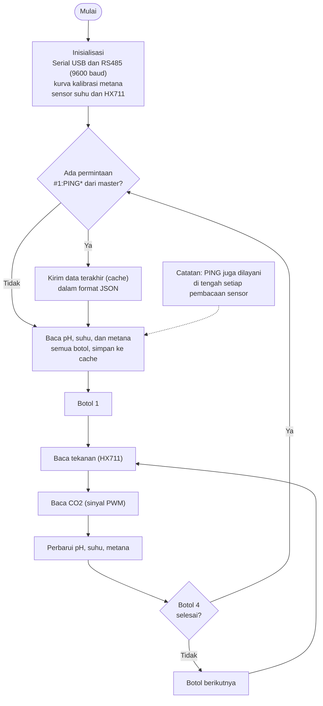

### Figure 1: setup() and loop()

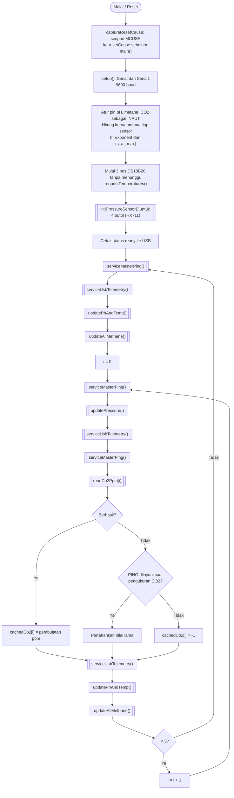

### Figure 2: serviceMasterPing() and handlePingStream()

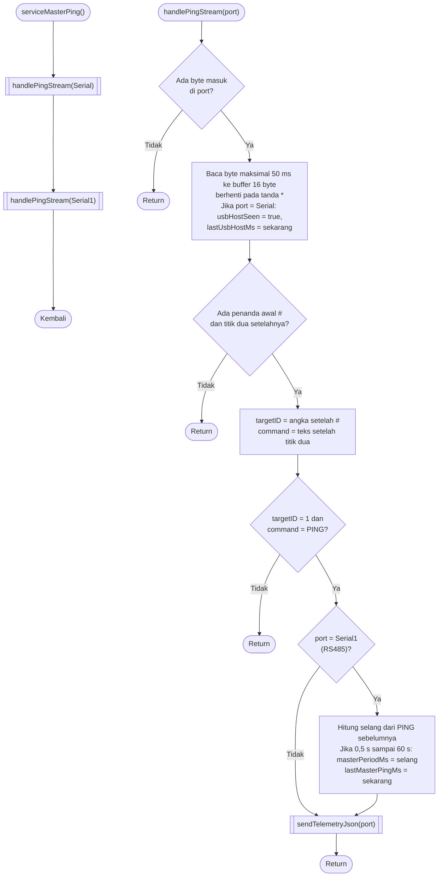

### Figure 3: serviceUsbTelemetry() and masterPollImminent()

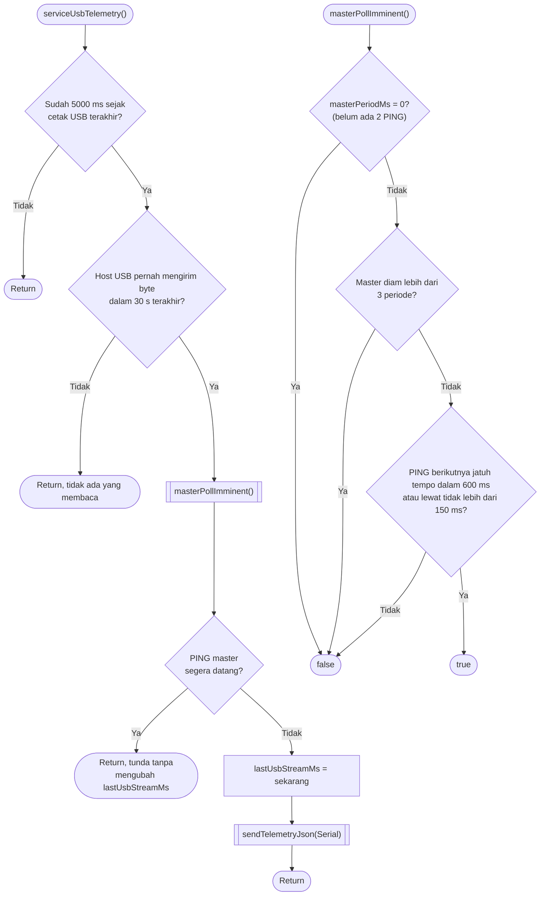

### Figure 4: sendTelemetryJson()

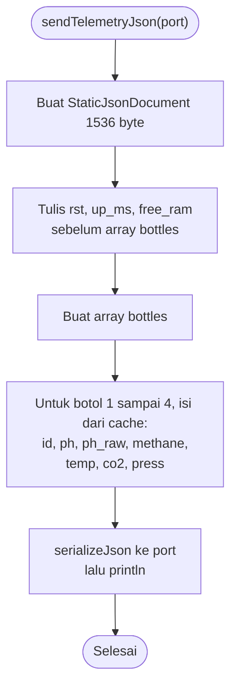

### Figure 5: updatePhAndTemp()

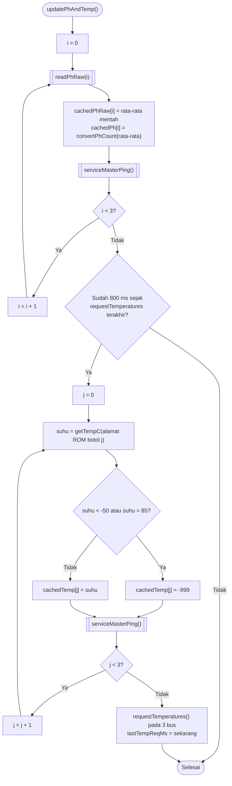

### Figure 6: readPhRaw() and convertPhCount()

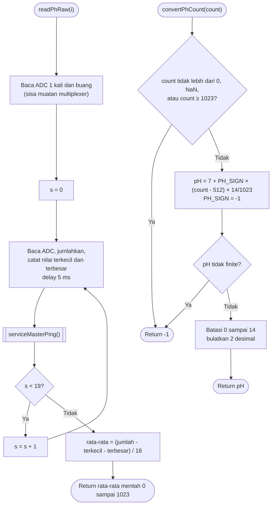

### Figure 7: updateAllMethane()

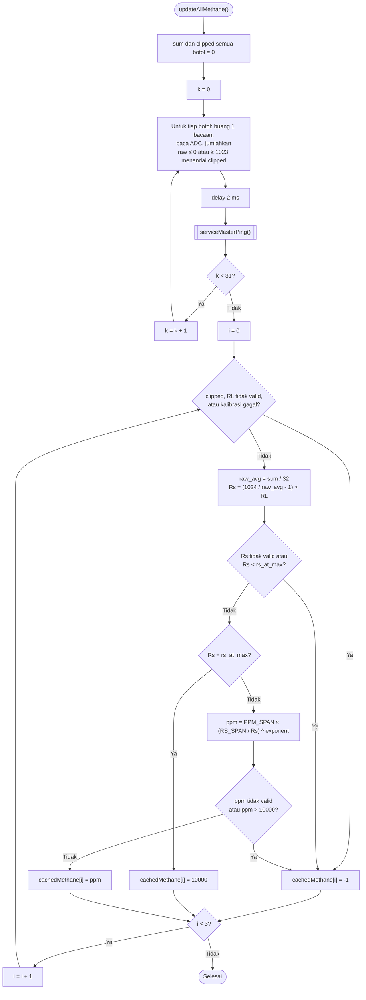

### Figure 8: updatePressure()

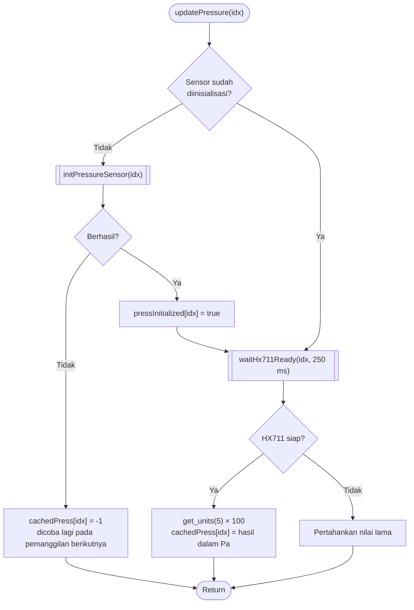

### Figure 9: initPressureSensor() and waitHx711Ready()

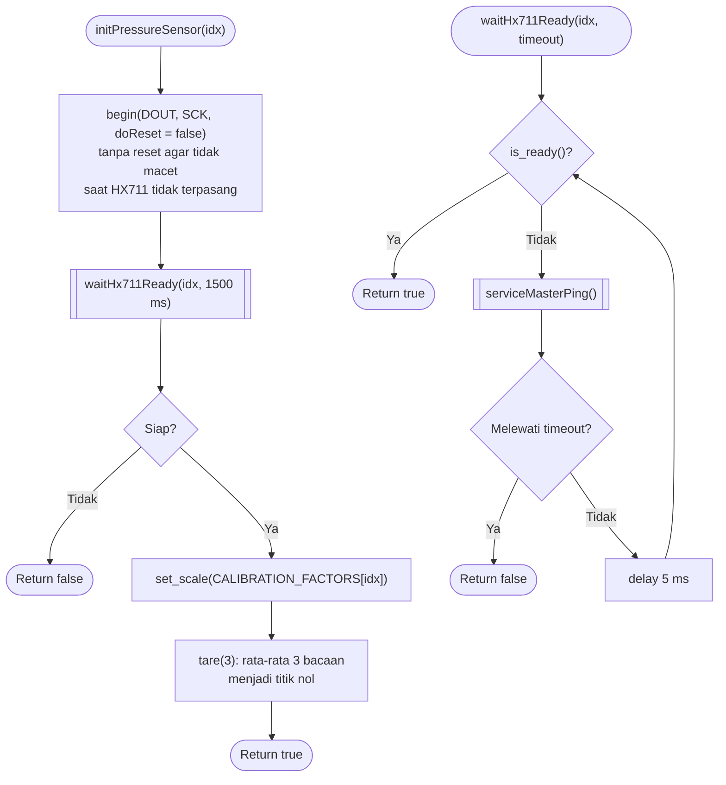

### Figure 10: readCo2Ppm()

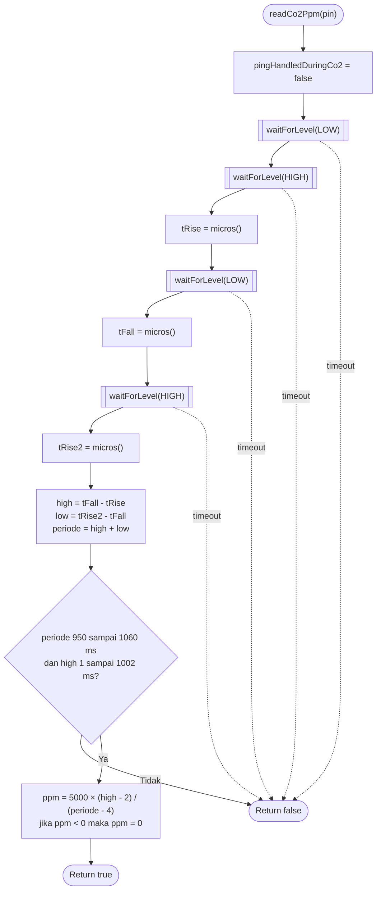

### Figure 11: waitForLevel()

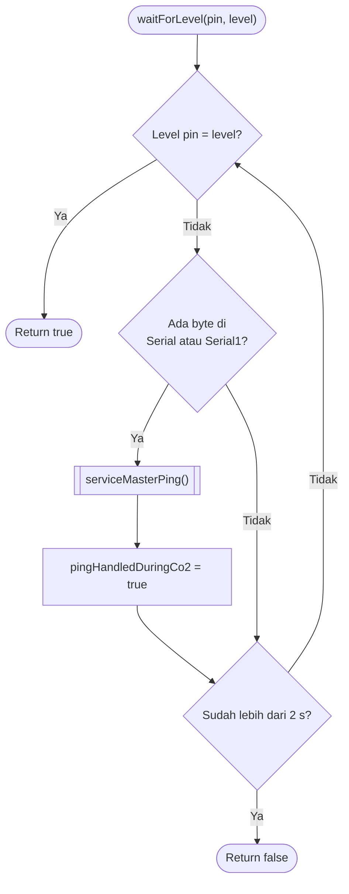

## 3. Regenerating the images

Images are rendered from the Mermaid blocks above with `@mermaid-js/mermaid-cli`
through Bun. The renderer needs a Chromium browser; on Windows, Edge works. Each
block starts with `%% name: NN-name`, which becomes the output file name.

```bash
PUPPETEER_SKIP_DOWNLOAD=1 bunx @mermaid-js/mermaid-cli \
  -p puppeteer.json -b white -s 3 -i NN-name.mmd -o NN-name.png
```

`puppeteer.json` points `executablePath` at the browser. The same command with
`-o NN-name.svg` produces the vector file.

---
Updated at 2026-11-24-22:10.
