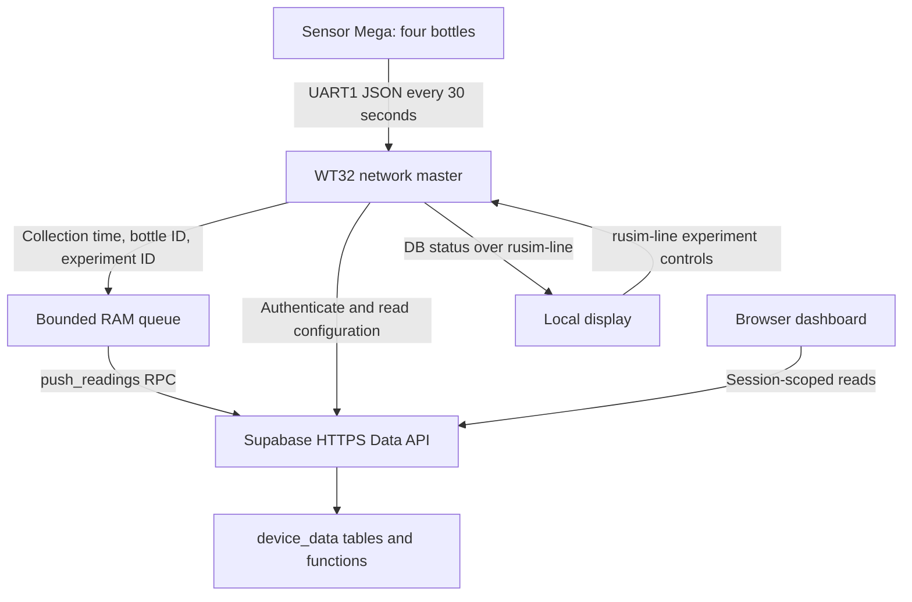

# Network master ↔ database communication plan

Status: implemented 2026-11-10. Reviewed 2026-11-10.

Implementation notes (2026-11-10):

- Firmware: `firmware/network-master/main.cpp` (session, schema headers, bounded
  reads, configuration pull, run snapshot, envelope, acknowledgement and fault
  classification) and `firmware/network-master/db_contract.h` (pure parsing and
  formatting). Display side: `firmware/display-v9/link_serial.*`,
  `ui_shell.cpp`, `screen_control.cpp`, `screen_info.cpp`.
- The four open choices in §4 were answered by the user: the operator picks the
  experiment id and the DB row for that id supplies duration/interval/setpoints;
  a run may not start until one successful pull since boot; `devices` stays
  authoritative over `device_config`; the DB line carries active and pending
  configuration for both display screens.
- The operator-selected experiment number is no longer incremented on start.
- Pressure values are preserved as emitted by the Mega slave (`press` is Pa per
  `new-slave.cpp`); the dashboard/CSV label was corrected from kPa to Pa.
- Tests: `firmware/tests/db-contract` (`pio run -e db-contract -t exec`) covers
  the envelope, sparse ids, nulls, non-finite rejection, UTC parsing, scalar
  acknowledgement and error codes. Builds run: `network-master`, `display-v9`,
  `display-sim`; `bun run test` in `dashboard/`. No hardware or live database
  was contacted.

Scope: `firmware/network-master/main.cpp`, the `device_data` migrations in `dashboard/supabase/migrations/`, and the dashboard's database client. No firmware, SQL, deployment, or credentials were changed during this review.

## 1. Recommendation and evidence

Keep the existing architecture: the WT32 uses verified HTTPS to call Supabase's PostgREST API. Do not connect the microcontroller directly to PostgreSQL. The existing device-session authentication and `push_readings` RPC already provide the required basic transport; MQTT, an Edge Function, and a new backend are not required for this step.



The diagram shows the proposed connected path; sensor enqueue and configuration pull are not currently connected. The user confirmed completing the previously planned DB configuration pull, no uploads while idle, and preserving firmware measurement values without unit conversion (§4).

### Source references

| Source | Finding |
|---|---|
| `firmware/network-master/main.cpp:1115–1185` | `sens_report_round()` parses four bottle slots and logs them, but never enqueues them. |
| `main.cpp:1017–1049` | `pushEnqueueRound()` exists, but assumes every array slot is present and derives bottle IDs from array indices. |
| `main.cpp:1239–1327` | Device authentication and latest-reading experiment query exist; expiry is not retained. |
| `main.cpp:1332–1431` | Encoder produces a bare array; uploader posts it directly and dequeues on any 2xx. |
| `main.cpp:1448–1468` | DB cycle runs every 30 seconds and attempts up to two upload batches. |
| `dashboard/supabase/migrations/20261016000000_add_push_readings_and_device_tables.sql` | Defines `push_readings(p_readings jsonb)`, `experiments`, and `device_config`. |
| `dashboard/supabase/migrations/20261001000000_lock_down_public_schema_for_public_deploy.sql:159–230` | Effective `authenticate()` definition: device metadata, session token, and 12-hour expiry. |
| `dashboard/supabase/migrations/20260930162000_add_device_data_token_auth.sql:38–77` | `x-device-session` lookup returns a device only for a live session. |
| `dashboard/src/supabase.ts:26–51` | Dashboard explicitly selects `device_data` and uses the same custom session header. |
| `dashboard/src/data.ts:8–14` and `docs/llm-generated/migration-plan.md:63–72` | Dashboard labels pressure as kPa; sensor-path documentation specifies Pa. |

Repository check: `origin/master` was fetched. This checkout is three commits behind, with an existing local `AGENTS.md` modification. None of those remote commits changes the reviewed firmware, database migrations/client, or database planning documents. No merge or checkout was performed. Required tools `bun`, `pio`, `uv`, and `graphify` are present; Graphify was queried before source discovery.

`docs/llm-summary/` does not exist in this checkout. Relevant existing documents under `docs/llm-generated/` were used instead. Historical plans contain stale Modbus terminology and refer to the highest configured experiment as “active”; the implementation below is the reference for this proposal. No live database or hardware was contacted.

## 2. Confirmed gaps to address

1. **No enqueue hook.** Successful sensor frames only produce logs. The upload queue stays empty.
2. **RPC argument mismatch.** The SQL function has a named `p_readings` argument. PostgREST requires `{"p_readings":[...]}`, not a raw array. Reserve wrapper bytes in the fixed upload buffer.
3. **Implicit schema selection.** Firmware omits profile headers. Local config exposes only `device_data`, so its default may work locally; a hosted default that includes `public` can resolve the wrong namespace. Select `device_data` explicitly on every request.
4. **Silent session expiry on reads.** RLS can produce HTTP 200 with `[]` for missing, revoked, or expired sessions. Reauthenticating only after 401/403 does not detect this case.
5. **Sparse bottles.** The parser tracks `seen[]`, but the enqueue function does not accept presence information. Enqueuing all four slots would turn an absent bottle into a fabricated all-null sample. Compacting the array without explicit IDs would renumber bottles.
6. **Experiment attribution.** The display supplies `expNum`, `durationH`, and `expRunning`, but none reaches the DB. Omitting `experiment_id` selects the highest ID in `device_data.experiments` at upload time, or 0 if none exists—not an actual running experiment. An outage spanning an experiment change could therefore mislabel old samples.
7. **Pressure units are not verified.** Sensor-path documentation specifies Pa while the dashboard labels pressure as kPa. Preserve the values sent by the firmware: do not rescale or recalibrate them. Verify the actual source unit and report any mismatch in documentation/dashboard labels; do not assume the documentation or label establishes the unit.
8. **Configuration pull is incomplete.** Firmware reads only the highest experiment ID appearing in `readings`. It does not fetch `experiments` or `device_config`, despite the earlier full-pull plan.
9. **Blocking and stale status.** A DB pass combines NTP, authentication, reads, uploads, and possible reauthentication. The aggregate wait can greatly exceed one 10-second HTTP timeout. `DB` lines repeat cached data even after failed reads, so link freshness is not database freshness.
10. **Unbounded response reads and permissive parsing.** DB calls use `getString()` and substring parsing. Use bounded responses, exact field/type validation, proper JSON escaping, and reject non-finite sensor values before encoding.

## 3. HTTP contract to implement

All paths below are relative to the configured Supabase URL. Keep `sbApplyTls()` and certificate verification; never fall back to `setInsecure()` for database traffic.

Common headers:

```http
apikey: <project publishable key or compatible existing anon key>
Accept: application/json
```

For GET requests, add `Accept-Profile: device_data`. For POST requests, add `Content-Profile: device_data` and `Content-Type: application/json`.

After authentication, also send `x-device-session: <session_token>`. This custom token is not a Supabase Auth JWT; do not put it in `Authorization`. Verify project-key/gateway requirements against the deployed environment. Never provision a service-role key or database password on the WT32.

### 3.1 Authenticate

```http
POST /rest/v1/rpc/authenticate
```

```json
{"p_token":"<device token supplied through private provisioning>"}
```

The response is a one-row JSON array containing `session_token`, `device_id`, `bottle_count`, nullable owner fields, and `expires_at`.

Implementation requirements:

- Parse the exact response fields, not the first 64-character hexadecimal run after a substring.
- Keep the session in RAM. Bind the queue to its provisioning/device identity and compare each authentication's returned `device_id` before flushing. A different identity must not receive previously queued samples; block and report the mismatch. Samples collected before first authentication must stay associated with their provisioning context. SQL still derives write identity from the session; do not add device identity to the payload.
- Parse `expires_at` and renew shortly before it, with a safety margin. The current SQL sets 12 hours; use the returned expiry rather than hardcoding it.
- On an unexpected empty collection read, confirm the live device with a narrow `GET /devices?select=device_id,bottle_count` before treating the experiment list as genuinely empty. An empty device result invalidates the local session; reauthenticate once with backoff. Do not treat every empty experiments list as an authentication error.
- Keep device credentials distinct from campus captive-portal credentials. Do not log tokens, credential bodies, or session headers.

### 3.2 Pull device and experiment information

Existing session-scoped endpoints:

```text
GET /rest/v1/devices?select=device_id,bottle_count,owner_name,owner_email
GET /rest/v1/device_config?select=bottle_count,owner_name,owner_email,updated_at
GET /rest/v1/experiments?select=experiment_id,started_at,duration_h,sample_interval_s,setpoints&order=experiment_id.desc
GET /rest/v1/readings?select=experiment_id&order=experiment_id.desc&limit=1
```

No caller-supplied device filter is necessary: RLS supplies the boundary. The configuration and experiment reads must use bounded responses/pagination, explicit field validation, and a documented local history limit rather than an unlimited allocation. Initially retain the existing 30-second polling interval.

Keep these concepts separate:

- Highest experiment with readings: the current `readings` query.
- Highest configured/reserved experiment: `experiments`, including entries with no readings.
- Actually running experiment: **not represented by current lifecycle state**.

Do not allocate an experiment number from `latest reading + 1` without considering configured IDs and concurrent operators. No create/start/stop RPC currently exists; the client roles have SELECT-only access to the configuration tables. `device_config` is only a one-time copy of `devices`, with no synchronization trigger; auth and bottle-bound validation still use `devices.bottle_count`.

### 3.3 Upload one collected round

```http
POST /rest/v1/rpc/push_readings
```

Example envelope, with illustrative measurements only. `pressure` is the numeric value received from the firmware, in its source unit; the example does not establish whether that unit is Pa or kPa:

```json
{
  "p_readings": [
    {
      "bottle_id": 0,
      "experiment_id": 7,
      "timestamp": "2026-11-10T10:30:00Z",
      "ph": 6.8,
      "pressure": 1.25,
      "temp": 39.0,
      "co2": 1200,
      "ch4": null
    }
  ]
}
```

- Upload only while an experiment is running. Do not enqueue idle readings or start a `push_readings` request while idle. A request already started during a run may complete after stop; the client cannot retroactively undo a server commit.
- One request contains at most 24 objects; the current Mega source has four bottle slots, not 24 actual bottles.
- Map Mega IDs 1–4 to DB IDs 0–3. Preserve holes. Configured capacity does not justify synthesizing samples for missing channels.
- `null` means a present bottle's sensor is unavailable. An absent bottle contributes no row.
- Fix collection time and experiment ID when the active-run frame is collected; retries must not recalculate either. Preserve measurement values in their firmware-provided units, with no pressure scaling or other unit conversion. Existing invalid-sensor-to-null mapping and field-name mapping remain part of the transport contract.
- The slave frame has no measurement timestamp. WT32 collection time is a proxy, not proof of when each sensor measured its value. Document this limitation; per-sensor acquisition timestamps require a later wire-protocol change.
- Require synchronized, plausible UTC. The server rejects dates before 2025-01-01 or more than 10 minutes ahead. Do not substitute upload time for readings collected without a trustworthy clock.
- Send neither device identity nor token hashes in reading objects. The RPC uses the session device and ignores unknown keys.

The successful JSON response is a scalar inserted-row count, such as `4`. The primary key is `(device_id, bottle_id, timestamp)`, excluding `experiment_id`. SQL uses `ON CONFLICT DO NOTHING`: a replay can legitimately return `0` or a partial count. Validate a success response as an integer between 0 and the sent row count, then remove the acknowledged batch. A mismatched body must not silently discard queued data.

A conflicting replay with different values is silently ignored, not corrected. This makes immutable queued samples essential. Detect and report locally observable timestamp reuse after clock adjustments before enqueueing. The current scalar RPC result cannot distinguish an exact replay from a different pre-existing value with the same key; validating the count does not prove stored values match the submission. Detecting arbitrary server-side conflicts would require an explicitly approved contract change.

### 3.4 Failure handling

| Failure | Proposed behavior |
|---|---|
| Timeout, dropped reply, transient 5xx, or 429 | Keep the exact queued batch, retry with capped exponential backoff and jitter; respect `Retry-After` when present. |
| Session rejection (`28000`, typically 401/403 through the API) | Reauthenticate once, then replay the unchanged batch. Repeated failures back off. |
| Empty read with apparently valid session | Probe the device row to distinguish unavailable session from an empty dataset. |
| Invalid payload (`22023` or another validation error) | Surface a bounded error code/message and stop hot-loop retries. Batch is atomic; keep it available for inspection. An explicit quarantine/discard policy needs approval. |
| Schema, function, or permission error | Mark DB configuration fault; do not loosen grants or disable TLS to compensate. |
| Invalid certificate or clock | Mark the specific fault and preserve queued samples. |

The existing oldest-drop overflow policy remains the eventual bound if a bad head batch blocks uploads. Do not claim retained data can never be lost.

## 4. Confirmed decisions

The user confirmed these choices on 2026-11-10:

| Topic | Agreed behavior |
|---|---|
| DB configuration | Complete the previously planned full device/experiment configuration pull, including applying DB duration/configuration and synchronizing it with the display. Do not defer it in favor of a telemetry-only milestone. |
| Configuration changes during a run | Apply changes next run. Capture a validated configuration snapshot when a run starts and keep that snapshot unchanged for the entire run. Continue polling DB configuration, but stage changes separately for a subsequent run. |
| Idle behavior | Do not upload while idle. Continue local sensor polling/logging and DB configuration reads, but do not enqueue idle measurements or initiate `push_readings` calls until an experiment is running. Do not create idle samples under experiment 0. |
| Measurement values and units | Keep the values sent by the firmware as they are. If the source is kPa, retain kPa; if it is another unit, preserve that unit. No Pa-to-kPa conversion, recalibration, or historical-data rewrite is authorized. Verify the source unit rather than infer it from the dashboard label. |

Pending active-run samples retain their original timestamps and experiment IDs while idle. Under the no-idle-upload rule, they wait until a run is active again before flushing; stopping does not discard the queue. This can delay the final samples of a run indefinitely if no later run starts, and the existing RAM overflow/reboot limits still apply. A request already in flight at stop can still complete.

The previous choices of HTTPS RPC writes, fixed RAM buffering, device-scoped reads, and oldest-drop overflow remain unchanged. Completing DB configuration reads does not mean automatically starting experiments from the highest configured ID: the current schema has no explicit running state. The existing display remains the start/stop interface unless separately changed.

At run start, freeze the selected experiment's validated configuration, including its ID, duration, sample interval, and setpoints. All rounds in that run use this active snapshot. DB updates received during the run update only a separate pending configuration; they must not change the active run's timing, experiment attribution, or displayed active settings. Apply the pending configuration at the next run's start, not at stop or at the next sample round. Distinguish active settings from pending next-run settings on the display. This does not authorize applying setpoints to actuators.

Detailed selection/conflict/offline rules still need to be specified before implementation: how an experiment configuration is selected, whether a run may start with cached configuration when DB access is unavailable, and how disagreement between `devices` and `device_config` is handled. These are not resolved by assuming the highest experiment is active. Present remaining behavioral choices before implementing them.

The earlier full-pull decision did not define remote start/stop or atomic number allocation; those are separate optional lifecycle extensions, not prerequisites for reading configuration. Do not automatically apply remote setpoints to physical actuators in this telemetry task.

## 5. Implementation order

### Phase 1 — Verify deployment and repair the HTTP contract

- Verify deployed migration history, exact RPC signatures, exposed `device_data` schema, and least-privilege grants using an isolated test device/environment.
- Add explicit schema headers, the named argument envelope, bounded JSON handling, parsed expiry, and failure classification.
- Add REST contract tests before connecting real sensor uploads. Test the deployed key/gateway combination without exposing secrets in logs.
- Basic telemetry through the existing RPC does not require a schema migration if the checked-in migrations are deployed.

### Phase 2 — Connect sensor acquisition to the queue

- Extend the enqueue interface with presence information or explicit bottle IDs. Preserve 0-based IDs instead of renumbering sparse input.
- Capture the active round's collection timestamp and use the frozen run configuration's experiment ID. A DB update must not change the active run or relabel queued samples. Do not enqueue idle readings. Preserve firmware-provided measurement values and units without pressure scaling or other unit conversion.
- Reject malformed/non-finite measurements, preserve per-sensor nulls, and keep completely absent bottles out of the batch.
- Call the enqueue path only for an accepted sensor frame with a trustworthy timestamp. Count skipped frames/rows separately from queue overflow.
- Keep the existing fixed 1200-row ring and 6144-byte upload buffer initially; include envelope overhead and worst-case numeric formatting in size tests.

### Phase 3 — Complete pull/control semantics

- Complete the previously planned device/configuration and experiment pulls and DB-to-display configuration application as confirmed in §4. Maintain separate active-run and pending-next-run configuration snapshots: polling can update pending settings, but promotion happens only at the next run's start. Resolve the remaining selection/conflict/offline details before implementation. This phase is required, not deferred; complete it before considering the integration finished.
- Resolve the duplicated configuration source before treating `device_config` as authoritative; it is currently read-only to clients. Only if separately requested, design lifecycle/start-stop/allocation SQL with explicit grants, session authorization, atomicity, and cross-device tests. Completing the existing read-only pull does not require these extensions.
- If dashboard code starts using the newer tables/RPCs, regenerate its database types; the current checked-in types omit them.
- Extend `rusim-line` status as necessary, updating both endpoints and the protocol document together. Proposed fields: DB state, queued rows, last successful read age, last acknowledged upload age, drops, and error category. Repeating a cached value must not refresh its DB-success timestamp.

### Phase 4 — Keep acquisition responsive and verify recovery

- Decouple sensor collection from cloud I/O. Use an explicit bounded I/O schedule with a worker if required; the main loop must keep servicing UART/display and acquisition while HTTPS is slow.
- Preserve one owner for queue mutation. If networking moves to another task, pass immutable batches and acknowledgements through bounded messages, or add explicit synchronization; do not share the ring unsafely. Account for an in-flight batch if oldest-drop advances the queue.
- Initially poll sensors every 30 seconds, enqueue only active-run rounds, and drain up to two actual sample rounds per 30-second cycle only while running. Check run state before each upload/retry; stopping pauses pending retries and retains queued active-run data. Adaptive scheduling/shorter intervals need measured throughput, not only a config value.
- Keep acquisition and upload independent of the unrelated lyrics connectivity-check service; failure of that service is not proof that Supabase or the physical experiment is unavailable. Do not stop an agreed local run merely because cloud I/O fails.

Nominal RAM capacity at 30-second sampling is 300 four-bottle rounds, about 150 minutes, or 50 full 24-bottle rounds, about 25 minutes. This assumes the sampling schedule is actually maintained. RAM contents are lost on reboot; samples before initial clock sync are not retained by the existing design. Flash-backed durability is a separate scope, not an implied guarantee.

## 6. Acceptance and validation

Future implementation must pass:

1. **HTTP contract:** authenticate array response, exact schema headers, named `p_readings` wrapper, scalar upload acknowledgement, bounded/malformed/oversized responses, and payload size limits.
2. **Acquisition mapping:** bottles 1 and 3 yield IDs 0 and 2 only; missing bottle is absent, missing sensor is null; pressure and all other valid measurements retain the firmware-provided values and units with no conversion; NaN/infinity are rejected.
3. **Sessions/security:** invalid token, 12-hour expiry and renewal, silent empty reads, revoked sessions, two-device isolation, queue collected under A then authenticated as B never uploaded into B, forged payload device ID ignored, direct table writes denied, token hashes/session table inaccessible.
4. **Atomicity/idempotency:** valid batch, exact replay, lost response followed by replay, mixed old/new duplicate keys, changed values with the same key, and one bad row rolling back the entire batch.
5. **Experiments/configuration/time:** full DB device/experiment configuration pull and display application; start with configuration A, fetch B mid-run, verify active settings/timing/attribution remain A, and verify B applies only when the next run starts; outage across a run change; no idle enqueue or new/retry upload while idle; stop retains pending active-run samples; a later run flushes them with their original experiment IDs; stable in-flight round; no readings before trustworthy UTC; future/old timestamps; locally detectable timestamp reuse after clock adjustment; configured experiment with no readings is not automatically running. Confirm that server conflicts remain first-write-wins and cannot be distinguished from exact replay by the current acknowledgement.
6. **Queue/responsiveness:** wraparound/overflow counts, no deletion before valid acknowledgement, RAM use after the dormant queue becomes live, network timeout without losing UART service, and backlog drain faster than collection.
7. **Build/bench:** run `pio run -e network-master`; host/temporary firmware tests belong in `firmware/tests/`. Use Bun for any dashboard tests. On hardware verify UART electrical levels, sensor values and actual source units, collection cadence, TLS handshake, reconnect, and rows visible to the dashboard.

Verify real WT32 TLS compatibility as part of the bench gate: Supabase announced removal of certain TLS 1.2 CBC suites starting no earlier than 2026-11-10. A valid CA bundle does not by itself prove compatible cipher negotiation. Keep certificate verification enabled.

Validation performed for this planning document: source/migration inspection, Graphify query, fetched-remote comparison, and current PostgREST/Supabase documentation review. Builds, automated behavior tests, live database queries, and hardware tests were not run; this change is documentation only.

## References

- [Existing database catalog](database.md)
- [Earlier RPC/buffering decisions](esp-db-sync.md#6-decisions-resolved-2026-10-16)
- [Sensor migration and units](migration-plan.md)
- [Current NTP/latest-experiment sync](db-sync-experiment-ntp.md)
- [rusim-line protocol](link-serial-protocol.md)
- [Supabase custom-schema headers](https://supabase.com/docs/guides/api/using-custom-schemas)
- [PostgREST named RPC arguments and JSON arrays](https://postgrest.org/en/stable/references/api/functions.html)
- [Supabase TLS cipher deprecation](https://supabase.com/changelog/cbc-tls-ciphers-deprecated)

---
Content generated by LLM in Freebuff.
